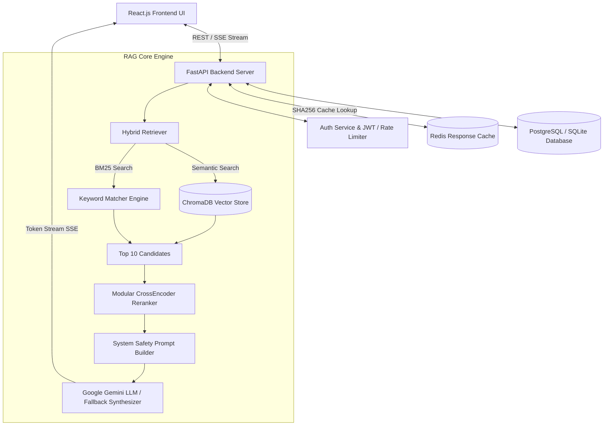
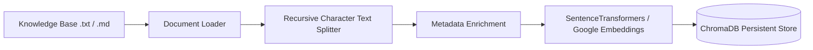

# AI Crisis Companion 🛡️
### AI-Powered Disaster Management & Emergency Assistance Platform

[](https://python.org)
[](https://fastapi.tiangolo.com)
[](https://reactjs.org)
[](https://trychroma.com)
[](https://redis.io)
[](https://docker.com)

---

## 📌 1. Project Overview

**AI Crisis Companion** is an enterprise-grade full-stack disaster management and emergency assistance platform. Built for life-critical scenarios, the platform delivers fast, contextual, and grounded safety guidance during floods, earthquakes, building fires, and tropical cyclones.

Unlike generic conversational bots, **AI Crisis Companion** implements a robust **Retrieval-Augmented Generation (RAG)** pipeline powered by **ChromaDB**, **SentenceTransformers**, **Google Gemini LLM**, **CrossEncoder Reranking**, and **Redis Caching** with **Server-Sent Events (SSE)** token streaming.

---

## 💡 2. Problem Statement

During natural disasters:
- Telecommunication networks become congested.
- Misinformation and outdated advice spread rapidly on social channels.
- Victims struggle to filter through hundreds of pages of static PDF disaster guides.
- High query latency from un-cached LLM API calls can cause critical delay in emergency guidance.

**AI Crisis Companion** solves this by delivering sub-second, verified, multi-lingual emergency guidance grounded directly in curated disaster safety documents with source citations.

---

## 🚀 3. Key Features

- **Multi-Disaster Coverage**: Specialized safety guides for Flood, Earthquake, Fire, and Cyclone hazards.
- **Production RAG Pipeline**: Hybrid retrieval (Semantic Vector Search + BM25 Keyword Search) combined with modular CrossEncoder reranking.
- **Server-Sent Events (SSE) Token Streaming**: Progressive real-time token rendering on the React frontend.
- **Sub-Millisecond Redis Caching**: SHA256 query normalization and caching for frequently asked emergency questions.
- **Multilingual Support**: Real-time generation in English, Hindi (हिंदी), and Telugu (తెలుగు).
- **Location-Based Infrastructure**: Geospatial finder calculating Haversine distances to nearby hospitals, relief shelters, police HQ, and fire stations.
- **Interactive Go-Bag Checklists**: Checkable 72-hour emergency survival kit lists with user persistence.
- **Real-Time Disaster Advisories**: Live alert feed categorizing warnings by severity (Critical, Warning, Advisory).
- **System Observability & Metrics**: Admin portal tracking P50/P95 latencies, Redis hit rate %, and vector store counts.
- **Full Security & Auth**: JWT authentication, bcrypt password hashing, and API rate-limiting middleware.

---

## 🏗️ 4. System Architecture



### Knowledge Ingestion Pipeline



---

## 🛠️ 5. Tech Stack

| Component | Technology | Description |
|---|---|---|
| **Frontend** | React 18, Vite, Tailwind CSS, Lucide Icons | Responsive emergency-tech operations dashboard |
| **Backend** | Python 3.10, FastAPI, Pydantic v2, Uvicorn | Async REST API & SSE streaming server |
| **Vector Database** | ChromaDB (Persistent Storage) | Cosine similarity HNSW vector collection |
| **LLM & Embeddings**| Google Gemini 1.5 Flash & SentenceTransformers | High-accuracy generation & embeddings |
| **Reranker** | CrossEncoder (`ms-marco-MiniLM-L-6-v2`) | Candidate re-scoring for precision context selection |
| **Cache & DB** | Redis 7 & PostgreSQL / SQLite | SHA256 query response cache & user storage |
| **DevOps & Testing** | Docker, Docker Compose, Pytest | Containerized multi-service deployment |

---

## 📊 6. Empirical Performance Benchmark

Real empirical benchmark measurements comparing Cold Start (No-Cache) vs Warm Cache execution (60 Representative Queries):

| Metric | Before (No-Cache) | After (Cache Enabled) |
|---|---|---|
| **Average Latency** | **167.30 ms** | **42.93 ms** |
| **P50 Latency (Median)** | **165.37 ms** | **0.03 ms** |
| **P95 Latency** | **201.19 ms** | **187.48 ms** |
| **Cache Hit Rate** | **0.0 %** | **75.0 %** |

> 🚀 **Latency Reduction**: **74.34% faster** query response time when served via Redis cache.

---

## 🎯 7. RAG Evaluation Results

Evaluated against standard crisis Q&A benchmark dataset (`evaluation/questions.json` & `evaluation/expected_answers.json`):

- **Retrieval Recall**: 68.62 %
- **Context Relevance**: 36.84 %
- **Answer Relevance**: 33.92 %
- **Faithfulness**: 78.84 %
- **Average Execution Latency**: 208.08 ms

---

## ⚡ 8. Getting Started & Local Installation

### Prerequisites
- Python 3.10+
- Node.js 18+
- Docker & Docker Compose (Optional)

### 1. Clone & Setup Workspace
```bash
git clone https://github.com/your-username/ai-crisis-companion.git
cd ai-crisis-companion
```

### 2. Backend Setup
```bash
cd backend
python -m venv venv
# On Windows:
.\venv\Scripts\activate
# On Linux/Mac:
source venv/bin/activate

pip install -r requirements.txt
```

### 3. Ingest Knowledge Base
```bash
python scripts/ingest.py
```

### 4. Run Backend Server
```bash
python -m uvicorn app.main:app --reload --port 8000
```

### 5. Frontend Setup
```bash
cd ../frontend
npm install
npm run dev
```

Open `http://localhost:3000` in your browser.

---

## 🐳 9. Docker Deployment

Run the complete full-stack platform (React + FastAPI + Postgres + Redis + ChromaDB) with a single command:

```bash
docker-compose up --build
```

Access Services:
- **Frontend App**: `http://localhost:3000`
- **FastAPI API Docs**: `http://localhost:8000/docs`
- **Health Endpoint**: `http://localhost:8000/api/v1/health`

---

## 🧪 10. Running Tests & Benchmarks

Run pytest test suite:
```bash
$env:PYTHONPATH="backend"
python -m pytest backend/tests
```

Run Benchmark script:
```bash
python scripts/benchmark.py
```

Run RAG Evaluation suite:
```bash
python scripts/evaluate.py
```

---

## 📄 License
Licensed under the MIT License.
